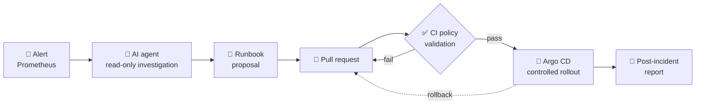

<!-- Banner -->
<p align="center">
  
</p>

<p align="center">
  <a href="https://readme-typing-svg.demolab.com">
    
  </a>
</p>

<p align="center">
  <a href="https://www.linkedin.com/in/ahmad-bensalah"></a>
  <a href="mailto:ahmad.bensalah.contact@gmail.com"></a>
  
</p>

---

## 👋 About me

Engineering student in **Data Engineering** at the **Faculty of Sciences of Sfax, Tunisia**. I sit at the intersection of **platform engineering, SRE and MLOps**: building the paved roads that let teams ship software and ML models safely, repeatably and fast.

```yaml
now:
  role: "DevOps / Platform / MLOps engineer in training"
  focus: ["GitOps", "Kubernetes platforms", "AI-assisted operations"]
  exploring: ["Agentic AI for SRE", "MCP", "Policy-as-code"]
  looking_for: "6-month PFE internship, February 2027"
```

---

## 🧰 Tech arsenal

<p align="center">
  
</p>

<div align="center">

| | |
|:--|:--|
| ☁️ **Cloud & virtualization** | AWS · Azure · GCP · Proxmox |
| 📦 **Containers & platforms** | Docker · Kubernetes · Helm · Kubeflow · KServe |
| 🔁 **Infra & GitOps** | Terraform · Ansible · Argo CD · GitHub Actions · Jenkins |
| 🔭 **Observability & security** | Prometheus · Grafana · OpenTelemetry · Trivy · Vault · Kyverno |
| 🧪 **MLOps & ML** | MLflow · scikit-learn · PyTorch · TensorFlow |
| 🤖 **AI engineering** | LangChain · LangGraph · CrewAI · n8n · RAG · MCP |
| 🌐 **Networking** | Istio · DNS · VPC · VPN/IPsec · Load balancing |
| 💻 **Development** | Python · Bash · SQL · FastAPI · Django |

</div>

---

## 🚀 Selected projects

### 🧠 SRE Copilot: AI-assisted remediation
> AI that investigates incidents, but **never touches production directly**. Every change goes through a reviewed PR.

`Azure OpenAI` `LangChain` `n8n` `Argo CD` `Prometheus` `Kyverno`



- Read-only investigation, human-reviewed changes, policy checks before anything ships.
- Controlled rollouts, rollback, and automatic post-incident reporting.

<br/>

<details open>
<summary><b>🏗️ Multi-Tenant MLOps Platform</b> &nbsp;·&nbsp; <code>Kubernetes</code> <code>Kubeflow</code> <code>Terraform</code> <code>Ansible</code> <code>Istio</code> <code>FastAPI</code></summary>

<br/>

Designed and deployed an ML platform on **private Proxmox infrastructure** serving multiple research teams.

- Automated infrastructure provisioning and cluster configuration end to end.
- Integrated Kubeflow, persistent storage and service-mesh capabilities.
- Built a **self-service portal** with SSO, RBAC, resource quotas and pipeline pre-provisioning.

</details>

<details>
<summary><b>💬 AI Developer Portal & ChatOps</b> &nbsp;·&nbsp; <code>GKE</code> <code>Amazon EKS</code> <code>Vertex AI</code> <code>Amazon Bedrock</code> <code>n8n</code> <code>Argo CD</code></summary>

<br/>

Natural-language interface for requesting infrastructure and operating cloud-native environments.

- Translates requests into **validated infrastructure blueprints**.
- Applies deployment policy checks before changes are released.
- Approval-based execution, audit logging and controlled rollouts.

</details>

<details>
<summary><b>🛡️ Automated DevSecOps Pipeline</b> &nbsp;·&nbsp; <code>Spring Boot</code> <code>GitOps</code> <code>CI/CD</code> <code>Monitoring</code> <code>Security Scanning</code></summary>

<br/>

Built during a DevSecOps internship.

- Continuous deployment with centralized monitoring.
- Real-time alerts and automated security analysis.
- Repeatable operational workflows from commit to production.

</details>

---

## 💼 Experience

```text
2026  ●  OLIVESOFT ············ MLOps & DevOps Intern
2026  ●  Diwan FM ············· DevOps Mission
2025  ●  SIFAST ··············· DevSecOps Intern
2024  ●  Orange Djagora Fablab · Full-Stack Intern
```

---

## 🏆 Research & community

- 📄 Paper accepted at **IEEE IECON 2026**: neuro-symbolic detection of zero-day hardware vulnerabilities in SoC designs.
- 🥇 **1st Prize**: IEEE WIEACT 4.0 Challenge
- 🥈 **2nd Prize**: IEEE PESTGM 7.0
- 🎤 **President**, IEEE Computational Intelligence Society, FSS Student Branch (2025–2026)

---

## 📊 GitHub activity

<p align="center">
  
  
</p>

<p align="center">
  
</p>

---

## 🎓 Education

**Engineering Degree in Data Engineering**: Faculty of Sciences of Sfax, Tunisia · *Expected 2027*

---

<h3 align="center">🤝 Let's build something reliable together</h3>

<p align="center">
  I'm looking for a <b>6-month PFE internship starting February 2027</b> in DevOps, Platform Engineering or MLOps.
</p>

<p align="center">
  <a href="https://github.com/ahmad-bensalah"></a>
  <a href="https://www.linkedin.com/in/ahmad-bensalah"></a>
  <a href="mailto:ahmad.bensalah.contact@gmail.com"></a>
</p>


